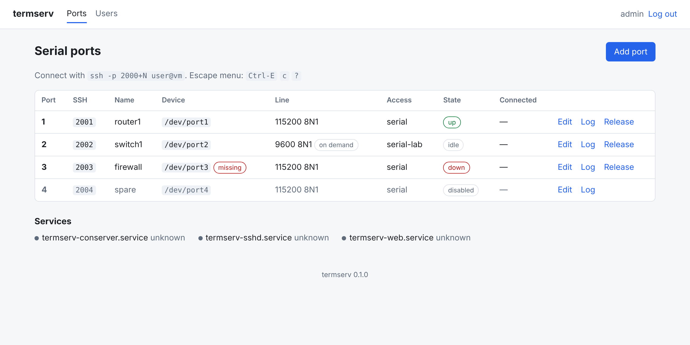
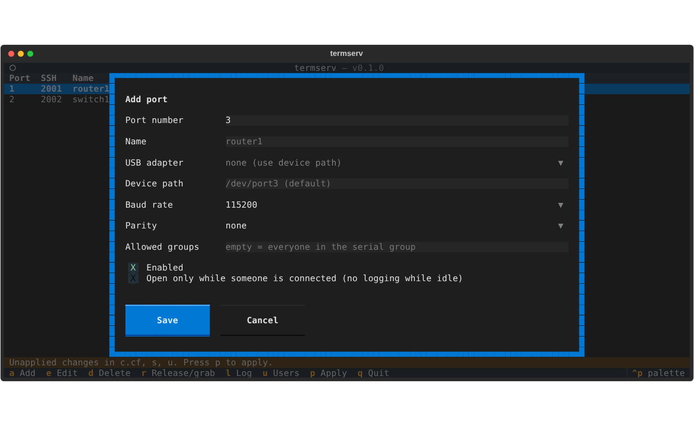

# termserv

Turn a small Linux board (Jetson Orin Nano, Raspberry Pi) into a serial console
server: `ssh -p 2001 user@host` lands on serial port 1, `-p 2002` on port 2, and so on.

```
ssh -p 2000+N ──> termserv sshd ──ForceCommand──> serial-attach ──> conserver (localhost) ──> /dev/portN ──> device
                        ▲                                               ▲
                        └──────── generated from /etc/termserv/ports.yaml ┘   (termservctl, web UI, TUI)
```

- **OpenSSH** (a second, dedicated instance) is the only network front door. It
  authenticates Linux users, enforces per-port groups and never gives a shell.
- **conserver** owns the serial ports: per-port baud/parity, timestamped logs of
  every port, one writer plus any number of read-only watchers, break signals.
- **ports.yaml** is the single source of truth. `termservctl`, the web
  UI and the TUI edit it, generate the sshd, conserver and udev config, syntax-check
  them, and only then reload the services.

Manage it from a **web UI** (HTTPS, log in with your Linux account), a **TUI** over
SSH (`sudo termserv-tui`) or the `termservctl` CLI. All three use the same
`termserv` Python package, so they validate and behave the same way.



## Install

On Ubuntu / Debian / Raspberry Pi OS, from a clone of this repo:

```sh
sudo ./install.sh
sudo usermod -aG serial alice          # who may use the serial ports
termservctl usb                        # find the USB path of each adapter
sudo termservctl set 1 --name router1 --baud 115200 --usb-path platform-3610000.usb-usb-0:1.2:1.0
sudo termservctl apply
ssh -p 2001 alice@consolehost
```

Then open `https://<host>:8443` and log in with a Linux account in the `sudo`
group. The certificate is self-signed, so the browser asks you to accept it once.

`install.sh` disables `brltty` and `ModemManager`, which grab USB-serial adapters
on Ubuntu, and the distro's own `conserver-server` service (termserv runs its own,
bound to localhost).

## Using a port

| Keys | Action |
| --- | --- |
| `Ctrl-E c .` | disconnect |
| `Ctrl-E c f` | force write access (if someone else holds it) |
| `Ctrl-E c l 0` | send a serial break |
| `Ctrl-E c ?` | help |

The first user on a port gets write access; later users watch read-only.
Logs are in `/var/log/conserver/portN.log`.

## Web UI

- **Ports**: live table (state, who is connected, missing adapters), add, edit,
  delete, release/grab, per-port log viewer. Edits are saved to `ports.yaml`; a
  banner shows when they are not live yet, and **Apply changes** activates them.
- **Users**: which Linux accounts are in each access group (`serial` plus any
  per-port groups); click to add or remove. Takes effect on the next SSH login.
- Login uses PAM (`/etc/pam.d/termserv-web`) and is limited to
  `settings.admin_group` (default `sudo`). Sessions last 8 hours.
- Service: `termserv-web`, port `settings.web_port` (default 8443), certificate in
  `/etc/termserv/web.crt` (replace it with your own if you like).

## TUI

```sh
sudo termserv-tui
```

Keys: `a` add, `e`/Enter edit, `d` delete, `r` release/grab, `l` log, `u` users,
`p` apply, `q` quit.



## Using a port locally (cable tests)

```sh
sudo termservctl release 1        # conserver lets go of port 1; other ports keep running
sudo screen /dev/port1 115200     # or add yourself to dialout to skip sudo
sudo termservctl grab 1           # back under termserv (a reboot also does this)
```

While a port is released, `ssh -p 2001` says so instead of connecting.

## ports.yaml

See [examples/ports.yaml](examples/ports.yaml). SSH port = `base_port + number`.

| Field | Meaning |
| --- | --- |
| `number` | port number N (SSH port 2000+N, conserver console `portN`) |
| `name` | optional alias, e.g. `router1` |
| `usb_path` | udev `ID_PATH` of the USB socket; generates a `/dev/portN` symlink, so a port is a physical socket |
| `device` | explicit device path for ports not on a USB socket (ignored when `usb_path` is set) |
| `baud`, `parity` | line settings (8 data bits, 1 stop bit) |
| `groups` | Linux groups allowed on this port (default: `settings.ssh_group`) |
| `enabled` | `false` closes the SSH port and drops the console |
| `ondemand` | `true` opens the device only while someone is connected, so it is free otherwise; nothing is logged while nobody is attached |

## termservctl

```
termservctl list [--status]     show ports (and who is connected)
termservctl set N [--name ...]  add or change a port
termservctl remove N
termservctl release N           free port N for local use (screen, minicom) until grab or reboot
termservctl grab N              take a released port back
termservctl usb                 list USB serial adapters and their USB paths
termservctl render sshd|conserver|udev
termservctl check               validate + syntax-check generated config
termservctl apply [--no-reload]
```

## Tests

```sh
pip install -e '.[test]'
python3 -m pytest tests/test_core.py tests/test_web.py tests/test_tui.py   # safe anywhere
```

`tests/e2e` builds the whole stack with virtual serial ports (socat pty pairs and a
fake device) and checks it over real SSH: port mapping, per-port groups, no shell,
no forwarding, shared read-only watching, logging. It creates users and writes
`/etc/termserv`, so run it only in a throwaway container or VM:

```sh
sudo TERMSERV_E2E=1 python3 -m pytest -v tests/e2e
```

## Notes

- `set`, `remove`, `release`, `grab`, `apply` and `check` need sudo; `list`, `usb`
  and `render` do not.
- The service names are `termserv-conserver` and `termserv-sshd`. Ubuntu's own
  `conserver-server` stays disabled; started by hand it exits with "no consoles found".

- Restarting `termserv-sshd` after a config change keeps open serial sessions
  (`KillMode=process`).
- With no ports enabled, `termserv-sshd` is stopped instead of falling back to port 22.
- Ubuntu's `pam_motd` may still print the message of the day on connect.
